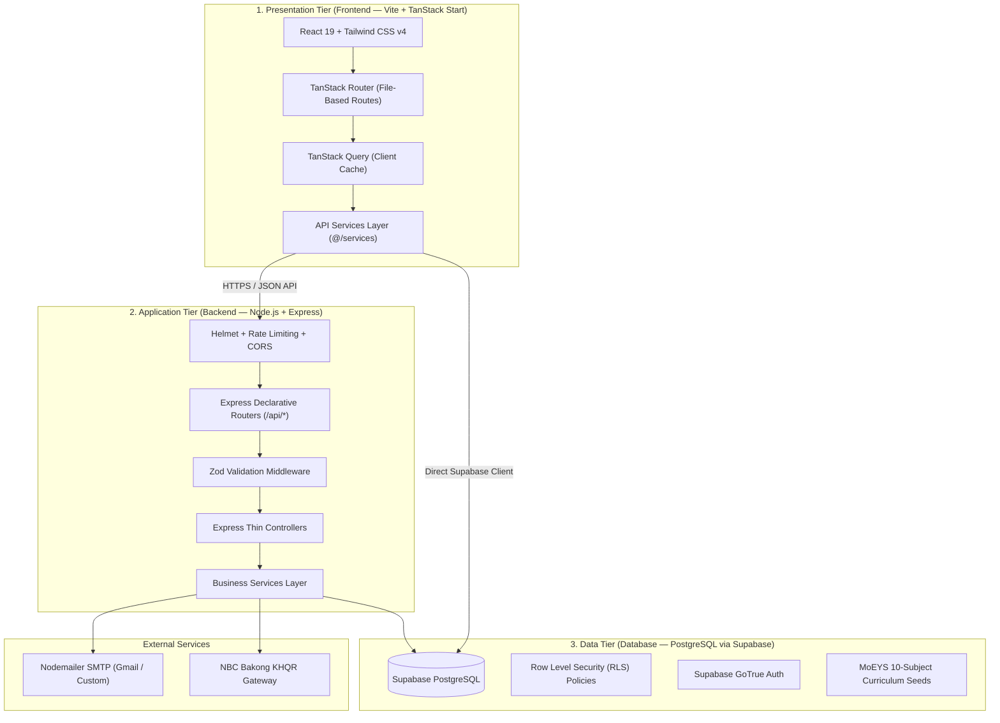
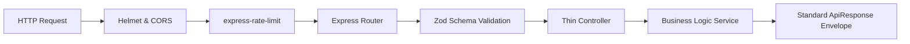
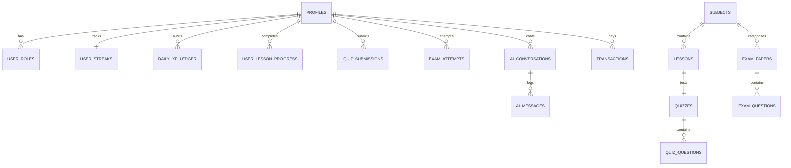
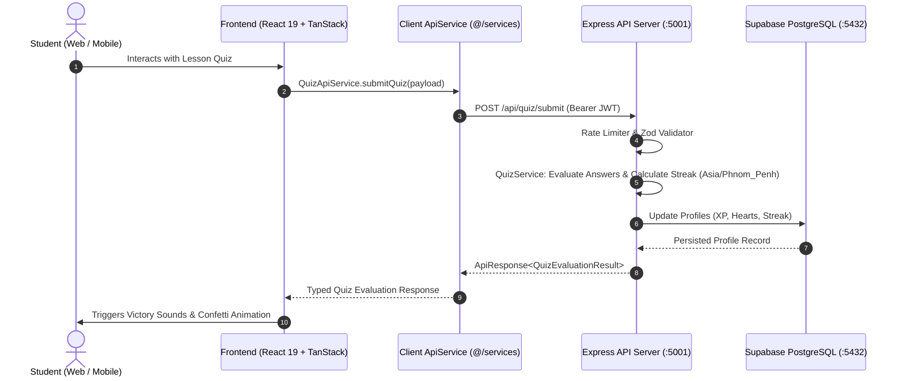

# ScienceKH — Full-Stack Project Architecture

> **ScienceKH (វិទ្យាសាស្ត្រ)**: Production-grade, bilingual (Khmer & English) STEM education platform for Cambodian Students in **Grades 7–12**, strictly aligned with the **Ministry of Education, Youth and Sport (MoEYS)** national curriculum.

---

## 1. High-Level System Architecture

ScienceKH is built as a modern, decoupled **3-Tier Full-Stack Architecture**:



---

## 2. Tier Breakdown & Responsibilities

### Tier 1: Presentation Tier (Frontend — `src/`)
Built with **React 19**, **Vite**, **TanStack Start / React Router**, and **Tailwind CSS v4**.

| Directory | Architectural Responsibility |
| :--- | :--- |
| `src/routes/` | **File-Based Pages & Layouts**: Defines unauthenticated (`/`, `/auth`) and authenticated routes (`/_authenticated/home`, `lessons`, `quiz`, `exams`, `tutor`, `leaderboard`, `profile`). |
| `src/services/` | **Client API Service Layer**: Centralized HTTP client (`ApiClient`) handling JWT tokens, base URLs, error normalization, and domain service abstractions (`auth.api`, `curriculum.api`, `quiz.api`, `exam.api`, `tutor.api`, `leaderboard.api`). |
| `src/services/supabase/` | **Data Access Layer (DAO)**: Strongly-typed database repositories (`LessonsRepository`, `ProfileRepository`) for querying and mutating Supabase records. |
| `src/types/` | **Unified TypeScript Domain Contracts**: DTOs, API envelopes, and entity types (`api.ts`, `curriculum.ts`, `gamification.ts`, `quiz.ts`, `exam.ts`). |
| `src/components/layout/` | **Global App Layout Shells**: Persistent mobile-first components (`BottomNav`, `PageShell`). |
| `src/components/features/` | **Feature Components**: Domain-scoped components (e.g., `curriculum/learning-path.tsx`). |
| `src/components/landing/` | **Marketing & Hero Modules**: Responsive bilingual landing sections (Hero, Bento Grid, Pricing, FAQ). |
| `src/components/auth/` | **Authentication Forms**: Sign-in, Sign-up, 6-digit OTP verification, and Password Reset cards. |
| `src/components/ui/` | **Design System Primitives**: Radix UI accessible headless wrappers styled with Tailwind. |
| `src/lib/curriculum/` | **MoEYS Curriculum Bank**: 150 lessons (Grades 7–12, 5 lessons per STEM subject) providing offline/instant rendering resilience. |

---

### Tier 2: Application Tier (Backend API — `server/src/`)
Built with **Node.js (v22+)**, **Express (v4.21+)**, and **TypeScript (v5.7+)** following the **Controller-Service-Repository** layered architecture.



| Directory | Layer & Purpose |
| :--- | :--- |
| `server/src/config/` | **Environment & Constants**: Centralized config (`env.ts`) reading ports, SMTP credentials, Supabase keys, and setting Cambodia timezone (`Asia/Phnom_Penh`). |
| `server/src/middleware/` | **Cross-Cutting Concerns**: Helmet security headers, CORS origin verification, sanitized logging, rate limiters, auth guards, and centralized production-safe error handler. |
| `server/src/validators/` | **Input Boundary Validation**: Reusable Zod middleware (`validateBody`, `validateQuery`, `validateParams`) ensuring inputs are typed and sanitized before reaching controllers. |
| `server/src/controllers/` | **HTTP Transport Layer**: Thin controllers responsible only for extracting request parameters, invoking services, and returning standard `{ success: true, data: T }` responses. |
| `server/src/services/` | **Core Business Domain Layer**: Pure, testable business logic (OTP hashing via HMAC-SHA256, streak and XP calculation, heart replenishment, exam scoring). |
| `server/src/routes/` | **Declarative Route Registries**: Pure route definitions binding URL paths, middleware chains, validators, and controller methods. |
| `server/src/types/` | **DTOs & Standard API Envelopes**: `ApiResponse<T>`, `sendSuccess()`, and `sendError()` helpers. |

---

### Tier 3: Data Tier (Database — `supabase/`)
Relational PostgreSQL database hosted on **Supabase** with **Row Level Security (RLS)** and automated migrations.



#### Core Data Domains:
1. **Identity & Auth**: `profiles`, `user_roles`, with `handle_new_user()` trigger for automated provisioning.
2. **MoEYS Curriculum**: `subjects` (10 official subjects), `lessons` (Grades 7–12 with bilingual content).
3. **Assessment & Quizzes**: `quizzes`, `quiz_questions`, `quiz_submissions`, `user_lesson_progress`.
4. **Gamification Integrity**: `user_streaks` (normalized to Cambodia date), `daily_xp_ledger` (anti-bot daily caps).
5. **National Exam Prep**: `exam_papers`, `exam_questions`, `exam_attempts` for BacII and Brevet past papers.
6. **Socratic AI Tutor**: `ai_conversations`, `ai_messages` for persistent dialogue history.
7. **Monetization**: `transactions` logging National Bank of Cambodia (NBC) compliant Bakong KHQR payments.

---

## 3. Request-Response Lifecycle & Data Flow



---

## 4. Full Directory Tree

```
ScienceKH/
├── ARCHITECTURE.md              # Global full-stack architecture specification
├── README.md                    # Project overview & quickstart
├── package.json                 # Monorepo/Root scripts & client dependencies
├── vite.config.ts               # Vite bundler & TanStack Router plugin configuration
│
├── src/                         # ==========================================
│   │                            # 1. FRONTEND TIER (React 19 + TanStack)
│   │                            # ==========================================
│   ├── routes/                  # File-based TanStack routes
│   │   ├── __root.tsx           # Global root layout (Navbar, Providers, Theme)
│   │   ├── index.tsx            # Landing page
│   │   ├── auth.tsx             # Bilingual authentication flow (Sign in, Sign up, OTP)
│   │   └── _authenticated/      # Protected authenticated routes
│   │       ├── home.tsx         # Student dashboard
│   │       ├── lessons.index.tsx# MoEYS learning path & grade selector
│   │       ├── lessons.$lessonId.quiz.tsx # Interactive STEM discovery lab
│   │       ├── exams.tsx        # BacII & Brevet past exam papers
│   │       ├── leaderboard.tsx  # National diamond league standings
│   │       ├── tutor.index.tsx  # Dr. Sokha AI STEM Tutor
│   │       └── profile.tsx      # Student profile & settings
│   │
│   ├── services/                # API client & domain service abstractions
│   │   ├── api/
│   │   │   ├── client.ts        # Typed fetch client with Bearer auth injection
│   │   │   ├── auth.api.ts      # OTP & password reset endpoints
│   │   │   ├── curriculum.api.ts# Grades, subjects, & unit lessons
│   │   │   ├── quiz.api.ts      # Gamification status & quiz submissions
│   │   │   ├── leaderboard.api.ts# Standings queries
│   │   │   ├── exam.api.ts      # Exam paper queries
│   │   │   └── tutor.api.ts     # AI tutor chat stream
│   │   ├── supabase/
│   │   │   ├── lessons.repository.ts # Supabase lessons & progress DAO
│   │   │   └── profile.repository.ts # Supabase profiles & streak DAO
│   │   └── index.ts             # Service barrel export
│   │
│   ├── types/                   # Shared TypeScript domain contracts
│   │   ├── api.ts               # ApiResponse<T> & ApiError
│   │   ├── curriculum.ts        # Lesson, Unit, Subject types
│   │   ├── gamification.ts      # Streak, XP, Hearts, League types
│   │   ├── quiz.ts              # Questions & quiz submission types
│   │   ├── exam.ts              # Exam paper types
│   │   └── index.ts             # Unified types barrel export
│   │
│   ├── components/              # Modular component hierarchy
│   │   ├── layout/              # BottomNav, PageShell
│   │   ├── features/            # Feature-scoped components (curriculum, quiz)
│   │   ├── auth/                # Auth forms & hero panels
│   │   ├── landing/             # Landing page sections
│   │   └── ui/                  # Radix UI primitive design system
│   │
│   └── lib/                     # Utilities & Curriculum Bank
│       ├── curriculum/          # 150 MoEYS Lessons (Grades 7–12)
│       ├── auth-context.tsx     # Supabase auth session provider
│       ├── i18n.ts              # Khmer/English localization dictionary
│       └── sound-effects.ts     # Audio feedback for gamification
│
├── server/                      # ==========================================
│   │                            # 2. BACKEND APPLICATION TIER (Express)
│   │                            # ==========================================
│   ├── package.json             # Express dependencies (Helmet, Zod, Nodemailer)
│   ├── tsconfig.json            # Node.js TypeScript compilation config
│   └── src/
│       ├── index.ts             # Express server entry point & middleware mounting
│       ├── config/
│       │   └── env.ts           # Centralized configuration & Cambodia timezone
│       ├── middleware/
│       │   ├── auth.ts          # Bearer JWT verification via Supabase
│       │   ├── rate-limit.ts    # express-rate-limiters (general, auth, exercise)
│       │   └── error-handler.ts # Production-safe sanitized error envelope
│       ├── validators/
│       │   ├── validator.middleware.ts # Zod express middleware
│       │   ├── auth.validator.ts       # Auth schemas
│       │   ├── quiz.validator.ts       # Quiz submission schemas
│       │   └── curriculum.validator.ts # Grade & subject parameter schemas
│       ├── controllers/
│       │   ├── auth.controller.ts
│       │   ├── curriculum.controller.ts
│       │   ├── quiz.controller.ts
│       │   ├── leaderboard.controller.ts
│       │   ├── exam.controller.ts
│       │   ├── vocab.controller.ts
│       │   ├── tutor.controller.ts
│       │   ├── exercise.controller.ts
│       │   ├── payment.controller.ts
│       │   └── health.controller.ts
│       ├── services/
│       │   ├── auth.service.ts        # OTP generation & HMAC-SHA256 hashing
│       │   ├── curriculum.service.ts  # Grade catalogs & units
│       │   ├── quiz.service.ts        # Gamification, hearts, streak calculation
│       │   ├── leaderboard.service.ts # Diamond league rankings
│       │   ├── exam.service.ts        # Past BacII & Brevet exams
│       │   ├── vocab.service.ts       # STEM vocabulary decks
│       │   ├── tutor.service.ts       # Socratic AI response generator
│       │   ├── exercise.service.ts    # Anti-cheat private question verification
│       │   └── mailer.ts              # Nodemailer email dispatcher
│       ├── routes/                    # Declarative Express routers
│       └── types/
│           ├── api.ts                 # Standard ApiResponse helpers
│           └── index.ts               # Domain types
│
└── supabase/                    # ==========================================
    │                            # 3. DATA TIER (PostgreSQL + RLS)
    │                            # ==========================================
    ├── README.md                # Database documentation & ER diagrams
    ├── 00_master_schema.sql     # Single idempotent master schema & seed script
    └── migrations/              # Versioned SQL migrations (Supabase CLI)
```

---

## 5. Development & Build Commands

### Frontend (`/`)
```bash
# Start frontend dev server on port 8080
npm run dev

# Type check frontend
npx tsc --noEmit

# Build production bundle with Nitro / Vite
npm run build
```

### Backend (`/server`)
```bash
# Start backend API server with tsx hot-reloading on port 5001
npm --prefix server run dev

# Type check and compile backend TypeScript
npm --prefix server run build

# Start production server
npm --prefix server start
```

### Concurrent Development (Root)
```bash
npm run dev:frontend   # Runs Vite on :8080
npm run dev:backend    # Runs Express API on :5001
```

