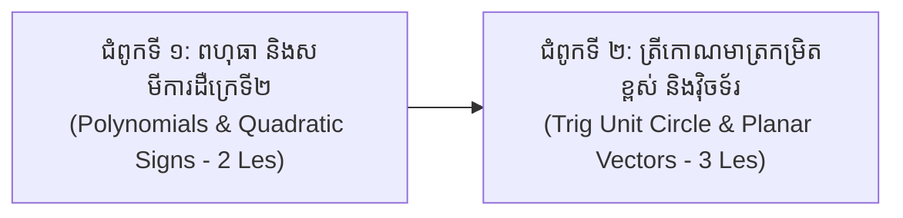

# ScienceKH — Grade 10 Mathematics (គណិតវិទ្យា ថ្នាក់ទី ១០)
## កម្មវិធីសិក្សាផ្លូវការ និងមាតិកាសៀវភៅពុម្ពគោល ក្រសួងអប់រំ យុវជន និងកីឡា

---

## A. Subject Overview
- **Official Khmer Name:** គណិតវិទ្យា ថ្នាក់ទី ១០
- **English Name:** Mathematics Grade 10
- **Target Cycle:** ថ្នាក់មូលដ្ឋានគ្រឹះរួម វិទ្យាល័យ (Upper Secondary Core Foundation)
- **Official Textbook Reference:** *គណិតវិទ្យា ថ្នាក់ទី ១០*, នាយកដ្ឋានអភិវឌ្ឍកម្មវិធីសិក្សា, ក្រសួងអប់រំ យុវជន និងកីឡា.
- **Weekly Class Hours:** 6 Hours / Week.

---

## B. Units & Lessons Breakdown (៥ មេរៀន — 5 In-Depth Lessons)

---

### UNIT 1: ពហុធា និងសមីការ-វិសមីការដឺក្រេទី២ (Polynomials & Quadratic Analysis)
- **Unit Number:** 1 (ជំពូកទី ១)
- **Lessons:**
  1. **Lesson 1.1 (`les-g10-math-01`):** ពហុធា និងការស្វែងរកឫសពហុធា (Polynomials, Synthetic Division & Roots)
     - *Remainder & Factor Theorems:* If polynomial $P(x)$ is divided by $(x - a)$, the remainder is $R = P(a)$. $(x - a)$ is a factor of $P(x) \iff P(a) = 0$.
     - *Horner's Method (Synthetic Division):* Efficient calculation of quotient $Q(x)$ and remainder.
  2. **Lesson 1.2 (`les-g10-math-02`):** សញ្ញានៃត្រីធាដឺក្រេទី២ និងវិសមីការ (Signs of Quadratic Trinomials)
     - *Trinomial:* $f(x) = ax^2 + bx + c$ ($a \ne 0$).
       - If $\Delta < 0$: $f(x)$ retains the same sign as $a$ for all $x \in \mathbb{R}$.
       - If $\Delta = 0$: $f(x)$ retains the same sign as $a$ for all $x \ne -\frac{b}{2a}$, and equals $0$ at $x = -\frac{b}{2a}$.
       - If $\Delta > 0$: $f(x)$ has two roots $x_1 < x_2$. Rule: **"ខាងក្រៅឫសយកសញ្ញាដូច $a$, ខាងក្នុងចន្លោះឫសយកសញ្ញាផ្ទុយ $a$"** (Outside roots: same sign as $a$; inside roots: opposite sign of $a$).

---

### UNIT 2: ត្រីកោណមាត្រកម្រិតខ្ពស់ និងវ៉ិចទ័រ (Trigonometry & Vector Analysis)
- **Unit Number:** 2 (ជំពូកទី ២)
- **Lessons:**
  3. **Lesson 2.1 (`les-g10-math-03`):** រង្វង់ត្រីកោណមាត្រ និងរូបមន្តបូក (Trigonometric Unit Circle & Addition Formulas)
     - *Radian Definition:* $\pi\text{ rad} = 180^\circ$. Coordinates on unit circle: $(\cos\alpha, \sin\alpha)$.
     - *Addition Formulas:*
       - $\cos(a \pm b) = \cos a \cos b \mp \sin a \sin b$
       - $\sin(a \pm b) = \sin a \cos b \pm \cos a \sin b$
       - $\tan(a + b) = \frac{\tan a + \tan b}{1 - \tan a \tan b}$.
     - *Double-Angle Formulas:* $\sin 2a = 2\sin a \cos a$; $\cos 2a = \cos^2 a - \sin^2 a = 2\cos^2 a - 1 = 1 - 2\sin^2 a$.
  4. **Lesson 2.2 (`les-g10-math-04`):** វ៉ិចទ័រក្នុងប្លង់កូអរដោនេ (Planar Coordinate Vectors)
     - *Vector Operations:* Given $\vec{u} = (x, y)$ and $\vec{v} = (x', y')$. Sum $\vec{u} + \vec{v} = (x + x', y + y')$; Magnitude $||\vec{u}|| = \sqrt{x^2 + y^2}$. Vector between two points $A(x_A, y_A)$ and $B(x_B, y_B)$: $\vec{AB} = (x_B - x_A, y_B - y_A)$.
  5. **Lesson 2.3 (`les-g10-math-05`):** ផលគុណស្កាលែនៃពីរវ៉ិចទ័រ (Scalar Dot Product)
     - *Geometric Definition:* $\vec{u} \cdot \vec{v} = ||\vec{u}|| \times ||\vec{v}|| \times \cos\theta$.
     - *Algebraic Coordinates:* $\vec{u} \cdot \vec{v} = x x' + y y'$.
     - *Orthogonality Criterion:* Two non-zero vectors are perpendicular ($\vec{u} \perp \vec{v}$) if and only if $\vec{u} \cdot \vec{v} = 0 \iff x x' + y y' = 0$.

---

## C. Grade 10 Mathematics Vocabulary Table

| Khmer Term | English Term | Academic Definition | Didactic Explanation | Contextual Example |
|---|---|---|---|---|
| ត្រីធាដឺក្រេទី២ | Quadratic Trinomial | កន្សោមពីជគណិត $f(x) = ax^2 + bx + c$ ដែល $a \ne 0$ | ពហុធាមាន ៣ តួ ដែលមានស្វ័យគុណខ្ពស់បំផុតស្មើ ២ | $f(x) = 2x^2 - 5x + 3$ |
| រង្វង់ត្រីកោណមាត្រ | Trigonometric Unit Circle | រង្វង់ដែលមានកាំស្មើ ១ និងទិសដៅវិជ្ជមានច្រាសទ្រនិចនាឡិកា | ឧបករណ៍កំណត់តម្លៃស៊ីនុស និងកូស៊ីនុសគ្រប់មុំ | កូអរដោនេ $(\cos\theta, \sin\theta)$ |
| ផលគុណស្កាលែ | Scalar Dot Product | ផលគុណនៃពីរវ៉ិចទ័រដែលផ្តល់លទ្ធផលជាចំនួនពិត (ស្កាលែ) | ការគុណវ៉ិចទ័រ $\vec{u}\cdot\vec{v} = xx' + yy'$ | បើកែងគ្នា $\vec{u}\cdot\vec{v} = 0$ |
| ម៉ូឌុលវ៉ិចទ័រ | Vector Magnitude | ប្រវែងពិតនៃអង្កត់វ៉ិចទ័រ $||\vec{u}|| = \sqrt{x^2+y^2}$ | ចម្ងាយពីចំណុចដើមទៅចំណុចចុងនៃវ៉ិចទ័រ | $\vec{u}=(3,4) \implies ||\vec{u}||=5$ |
