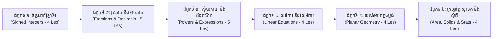

# ScienceKH — Grade 7 Mathematics (គណិតវិទ្យា ថ្នាក់ទី ៧)
## កម្មវិធីសិក្សាផ្លូវការ និងមាតិកាសៀវភៅពុម្ពគោល ក្រសួងអប់រំ យុវជន និងកីឡា

---

## A. Subject Overview
- **Official Khmer Name:** គណិតវិទ្យា ថ្នាក់ទី ៧
- **English Name:** Mathematics Grade 7
- **Target Cycle:** អនុវិទ្យាល័យ (Lower Secondary Education)
- **Official Textbook Reference:** *គណិតវិទ្យា ថ្នាក់ទី ៧*, នាយកដ្ឋានអភិវឌ្ឍកម្មវិធីសិក្សា, ក្រសួងអប់រំ យុវជន និងកីឡា (Ed. 2017–2022).
- **Weekly Class Hours:** 6 Hours / Week (approx. 180 hours/academic year).

### Purpose & Educational Value:
Mathematics in Grade 7 marks the profound transition from concrete arithmetic to abstract algebraic reasoning and deductive geometry. It equips Cambodian learners with numerical agility across positive and negative quantities, single-variable equation modeling, spatial visualization, and data literacy.

### Core Competencies Developed:
1. Operations on signed integers, absolute values, fractions, decimals, and exponents.
2. Algebraic manipulation of linear expressions, monomials, and polynomials.
3. Solving first-degree equations $ax + b = c$ and real-world proportional word problems.
4. Geometric construction and proof of parallel line angle properties ($180^\circ$ triangle sum).
5. Area/volume calculations and frequency distribution data interpretation.

---

## B. Master Units & Lessons Breakdown (២៦ មេរៀន — 26 Lessons)

> [!NOTE]
> **Textbook Alignment & Lesson Granularity**: The official MoEYS printed textbook *គណិតវិទ្យា ថ្នាក់ទី ៧* comprises **22 core chapter lessons** (ranging from signed numbers, fractions, decimals, algebraic expressions, linear equations, inequalities, coordinate geometry, angle theorems, reflection, to probability and bar charts). In ScienceKH's digital pedagogy, dense composite lessons (such as exponent laws and multi-step polygon area calculations) are decomposed into 26 focused learning nodes to optimize student comprehension and spaced repetition without omitting a single official MoEYS syllabus objective.

---

### UNIT 1: ចំនួនគត់រ៉ឺឡាទីវ និងតម្លៃដាច់ខាត (Signed Integers & Absolute Value)
- **Unit Number:** 1 (ជំពូកទី ១)
- **Estimated Duration:** 28 Class Hours
- **Prerequisites:** Primary whole-number arithmetic, vertical number lines.
- **Unit Competencies:** Students can locate positive and negative integers on a horizontal number line, calculate absolute values $|a|$, and apply addition, subtraction, multiplication, and division sign rules.

#### Lessons in Unit 1:
1. **Lesson 1.1 (`les-g7-math-01`):** ចំនួនគត់រ៉ឺឡាទីវ និងបន្ទាត់ចំនួន (Signed Integers & The Number Line)
   - *Main Concepts:* Natural numbers $\mathbb{N}$, positive integers ($+1, +2...$), zero ($0$), and negative integers ($-1, -2...$). The number line as an ordered axis where left is smaller and right is greater.
   - *Definitions:* ចំនួនគត់រ៉ឺឡាទីវ (Integer): Any whole number positive, negative, or zero; តម្លៃដាច់ខាត (Absolute Value): $|a|$ is the non-negative distance from $0$ to $a$.
   - *Worked Example:* Compare $-7$ and $-2$. Since $-7$ lies further to the left of $0$ on the number line than $-2$, $-7 < -2$.

2. **Lesson 1.2 (`les-g7-math-02`):** ប្រមាណវិធីបូក និងដកចំនួនគត់រ៉ឺឡាទីវ (Addition & Subtraction of Integers)
   - *Main Concepts:* Same signs: add magnitudes and keep common sign ($(-3) + (-5) = -8$). Different signs: subtract smaller magnitude from larger and keep sign of greater magnitude ($(-7) + (+15) = +8$). Subtraction rule: $a - b = a + (-b)$.
   - *Worked Example:* Calculate $(-12) - (-18) = (-12) + (+18) = +(18 - 12) = +6$.

3. **Lesson 1.3 (`les-g7-math-03`):** ផលគុណ និងផលចែកចំនួនគត់រ៉ឺឡាទីវ (Multiplication & Division of Integers)
   - *Main Concepts:* Like signs produce positive results ($(+)\times(+) = +$, $(-)\times(-) = +$). Opposite signs produce negative results ($(+)\times(-) = -$, $(-)\times(+) = -$). Division by zero is undefined.
   - *Worked Example:* $(-4) \times (-9) = +36$; $(-72) \div (+8) = -9$.

4. **Lesson 1.4 (`les-g7-math-04`):** តម្លៃដាច់ខាត និងលក្ខណៈនៃប្រមាណវិធី (Absolute Value & Associative/Distributive Laws)
   - *Main Concepts:* Properties: Commutative $a+b=b+a$, Associative $(a+b)+c=a+(b+c)$, Distributive $a(b+c)=ab+ac$.
   - *Worked Example:* Evaluate $|-15| + |+8| - |-4| = 15 + 8 - 4 = 19$.

---

### UNIT 2: ប្រភាគ ទសភាគ និងភាគរយ (Fractions, Decimals & Percentages)
- **Unit Number:** 2 (ជំពូកទី ២)
- **Estimated Duration:** 32 Class Hours
- **Prerequisites:** Integer division, prime numbers.

#### Lessons in Unit 2:
5. **Lesson 2.1 (`les-g7-math-05`):** ប្រភាគ និងប្រភាគសមមូល (Fractions & Equivalent Fractions)
   - *Main Concepts:* Numerator and denominator ($\frac{a}{b}, b \ne 0$), simplification via Greatest Common Divisor (GCD/ត.ច.ប), cross-multiplication test for equivalence ($\frac{a}{b} = \frac{c}{d} \iff a \cdot d = b \cdot c$).
6. **Lesson 2.2 (`les-g7-math-06`):** ប្រមាណវិធីបូក និងដកប្រភាគ (Addition & Subtraction of Fractions)
   - *Main Concepts:* Common denominators; finding the Least Common Multiple (LCM/ព.ប.ត) of denominators.
   - *Worked Example:* $\frac{3}{4} + \frac{5}{6} = \frac{3 \times 3}{12} + \frac{5 \times 2}{12} = \frac{9 + 10}{12} = \frac{19}{12}$.
7. **Lesson 2.3 (`les-g7-math-07`):** ផលគុណ និងផលចែកប្រភាគ (Multiplication & Division of Fractions)
   - *Main Concepts:* Multiplying numerators and denominators ($\frac{a}{b} \times \frac{c}{d} = \frac{ac}{bd}$); dividing by multiplying by the reciprocal ($\frac{a}{b} \div \frac{c}{d} = \frac{a}{b} \times \frac{d}{c}$).
8. **Lesson 2.4 (`les-g7-math-08`):** ចំនួនទសភាគ និងប្រមាណវិធី (Decimals & Operations)
   - *Main Concepts:* Place value (tenths, hundredths, thousandths), moving the decimal point in multiplication/division by powers of 10.
9. **Lesson 2.5 (`les-g7-math-09`):** ភាគរយ និងចំណោទជាក់ស្តែង (Percentages & Applications)
   - *Main Concepts:* Conversion: $\frac{p}{100} = p\%$. Calculating percentage discount, interest, and taxes in market transactions.

---

### UNIT 3: ស្វ័យគុណ និងកន្សោមពីជគណិត (Powers, Exponents & Algebraic Expressions)
- **Unit Number:** 3 (ជំពូកទី ៣)
- **Estimated Duration:** 30 Class Hours
- **Prerequisites:** Multiplication of signed numbers.

#### Lessons in Unit 3:
10. **Lesson 3.1 (`les-g7-math-10`):** ស្វ័យគុណ និងគោល (Powers, Bases & Positive Exponents)
    - *Main Concepts:* $a^n = \underbrace{a \times a \times \dots \times a}_{n \text{ times}}$. Base $a$, exponent $n$. Convention: $a^0 = 1$ ($a \ne 0$), $a^1 = a$.
11. **Lesson 3.2 (`les-g7-math-11`):** វិធានគុណ និងចែកស្វ័យគុណ (Exponent Product & Quotient Rules)
    - *Rules:* Product: $a^m \cdot a^n = a^{m+n}$; Quotient: $\frac{a^m}{a^n} = a^{m-n}$ ($a \ne 0$).
    - *Worked Example:* $2^3 \times 2^4 = 2^{3+4} = 2^7 = 128$; $\frac{5^6}{5^2} = 5^{6-2} = 5^4 = 625$.
12. **Lesson 3.3 (`les-g7-math-12`):** ស្វ័យគុណនៃស្វ័យគុណ និងផលគុណ (Powers of Powers & Products)
    - *Rules:* $(a^m)^n = a^{m \cdot n}$; $(ab)^n = a^n b^n$; $(\frac{a}{b})^n = \frac{a^n}{b^n}$.
13. **Lesson 3.4 (`les-g7-math-13`):** កន្សោមពីជគណិត និងតម្លៃលេខ (Algebraic Expressions & Value Substitution)
    - *Main Concepts:* Constant terms, variable letters ($x, y, a$). Substituting numerical values into expressions.
    - *Worked Example:* Evaluate $E = 3x^2 - 2x + 5$ for $x = -2$. $E = 3(-2)^2 - 2(-2) + 5 = 3(4) + 4 + 5 = 12 + 4 + 5 = 21$.
14. **Lesson 3.5 (`les-g7-math-14`):** ឯកធា និងពហុធាបឋម (Monomials & Basic Polynomials)
    - *Main Concepts:* Monomial structure ($c \cdot x^k$). Like terms (monomials with identical variable powers). Adding like terms: $5x^2 + 3x^2 = 8x^2$.

---

### UNIT 4: សមីការដឺក្រេទី១ និងវិសមីការ (Linear Equations & Inequalities)
- **Unit Number:** 4 (ជំពូកទី ៤)
- **Estimated Duration:** 28 Class Hours

#### Lessons in Unit 4:
15. **Lesson 4.1 (`les-g7-math-15`):** សមីការដឺក្រេទី១ មានមួយអថេរ (Solving 1-Variable Linear Equations)
    - *Standard Form:* $ax + b = c \implies ax = c - b \implies x = \frac{c - b}{a}$ ($a \ne 0$).
16. **Lesson 4.2 (`les-g7-math-16`):** សមាមាត្រ និងផលធៀប (Ratios & Proportions)
    - *Property:* $\frac{a}{b} = \frac{c}{d} \iff ad = bc$. Finding unknown $x$: $x = \frac{bc}{a}$.
17. **Lesson 4.3 (`les-g7-math-17`):** វិសមីការដឺក្រេទី១ មានមួយអថេរ (Linear Inequalities)
    - *Rule:* Multiplying or dividing both sides by a negative number reverses the inequality symbol ($<$ becomes $>$, $\le$ becomes $\ge$).
18. **Lesson 4.4 (`les-g7-math-18`):** ការដោះស្រាយចំណោទដោយប្រើសមីការ (Word Problems & Real-World Modeling)
    - *Steps:* 1. Choose the variable $x$. 2. Formulate the equation. 3. Solve for $x$. 4. Verify against contextual constraints.

---

### UNIT 5: ធរណីមាត្រក្នុងប្លង់ បន្ទាត់ មុំ និងត្រីកោណ (Planar Geometry)
- **Unit Number:** 5 (ជំពូកទី ៥)
- **Estimated Duration:** 32 Class Hours

#### Lessons in Unit 5:
19. **Lesson 5.1 (`les-g7-math-19`):** បន្ទាត់ បន្ទាត់កាត់ និងប្រភេទមុំ (Lines, Transversals & Angles)
    - *Main Concepts:* Acute ($<90^\circ$), Right ($90^\circ$), Obtuse ($>90^\circ$), Straight ($180^\circ$). Vertically opposite angles are equal.
20. **Lesson 5.2 (`les-g7-math-20`):** បន្ទាត់ស្រប និងមុំឆ្លាស់ក្នុង (Parallel Lines & Transversal Angle Theorems)
    - *Theorem:* When two parallel lines are cut by a transversal, alternate interior angles are equal, and corresponding angles are equal.
21. **Lesson 5.3 (`les-g7-math-21`):** ត្រីកោណ និងផលបូកមុំក្នុងត្រីកោណ (Triangles & 180° Sum Theorem)
    - *Theorem:* In any triangle $\triangle ABC$, $\angle A + \angle B + \angle C = 180^\circ$.
22. **Lesson 5.4 (`les-g7-math-22`):** ចតុកោណកែង ចតុកោណស្មើ និងការ៉េ (Quadrilaterals: Rectangles, Rhombuses & Squares)

---

### UNIT 6: បរិមាត្រ ផ្ទៃក្រឡា សូលីត និងស្ថិតិបឋម (Perimeter, Area, 3D Solids & Statistics)
- **Unit Number:** 6 (ជំពូកទី ៦)
- **Estimated Duration:** 30 Class Hours

#### Lessons in Unit 6:
23. **Lesson 6.1 (`les-g7-math-23`):** បរិមាត្រ និងផ្ទៃក្រឡាពហុកោណ (Perimeters & Areas of Polygons)
    - *Formulas:* Triangle: $S = \frac{1}{2} b h$; Rectangle: $S = l \times w$; Trapezoid: $S = \frac{(a+b)h}{2}$.
24. **Lesson 6.2 (`les-g7-math-24`):** រង្វង់ បរិមាត្រ និងក្រឡាផ្ទៃ (Circles: Circumference & Area)
    - *Formulas:* Circumference $C = 2\pi r = \pi d$; Area $S = \pi r^2$ ($\pi \approx 3.14159$).
25. **Lesson 6.3 (`les-g7-math-25`):** សូលីត គូប និងប្រលេពីប៉ែតកែង (3D Solids: Cubes & Rectangular Prisms)
    - *Formulas:* Volume $V = l \times w \times h$; Cube $V = a^3$; Total surface area $S_{total} = 2(lw + lh + wh)$.
26. **Lesson 6.4 (`les-g7-math-26`):** ស្ថិតិបឋម និងតារាងប្រេកង់ (Descriptive Statistics & Frequency Tables)
    - *Main Concepts:* Data collection, tallying, frequency ($f_i$), sample size $N = \Sigma f_i$, arithmetic mean $\bar{x} = \frac{\Sigma x_i f_i}{N}$.

---

## C. Key Vocabulary Table (MoEYS Standard Khmer-English)

| Khmer Term | English Term | Academic Definition | Didactic Explanation | Contextual Example |
|---|---|---|---|---|
| ចំនួនគត់រ៉ឺឡាទីវ | Signed Integer | ចំនួនគត់វិជ្ជមាន ចំនួនសូន្យ និងចំនួនគត់អវិជ្ជមាន | លេខគត់ទាំងឡាយដែលរាប់ពីសូន្យទៅស្តាំ និងទៅឆ្វេង | $\{-3, -2, -1, 0, 1, 2, 3\}$ |
| តម្លៃដាច់ខាត | Absolute Value | ចម្ងាយពីចំណុចសូន្យ $0$ ទៅកាន់ចំនួននោះលើបន្ទាត់ចំនួន | តម្លៃលេខវិជ្ជមានជានិច្ច គ្មានសញ្ញាដកឡើយ | $|-8| = 8$, $|+5| = 5$ |
| ស្វ័យគុណ | Power / Exponent | ផលគុណនៃកត្តាស្មើៗគ្នា $a^n = a \times a \times \dots \times a$ | ការសរសេរបង្ខិតនៃប្រមាណវិធីគុណដដែលៗ | $2^4 = 2 \times 2 \times 2 \times 2 = 16$ |
| សមីការដឺក្រេទី១ | Linear Equation | សមភាពពីជគណិតដែលមានអថេរដឺក្រេខ្ពស់បំផុតស្មើ ១ | សមីការ $ax + b = c$ ដែលរកតម្លៃ $x$ មិនស្គាល់ | $3x + 6 = 15 \implies x = 3$ |
| បន្ទាត់ស្រប | Parallel Lines | បន្ទាត់ពីរក្នុងប្លង់តែមួយដែលមិនជួបគ្នាទោះអូសបន្លាយដល់ណា | បន្ទាត់ដែលមានចម្ងាយស្មើគ្នារហូត | ផ្លូវដែកកាត់ព្រៃវែង $(d_1) \parallel (d_2)$ |
| មុំឆ្លាស់ក្នុង | Alternate Interior Angles | មុំពីរស្ថិតនៅសងខាងបន្ទាត់កាត់ និងចន្លោះបន្ទាត់ស្របពីរ | មុំដែលមានទំហំប៉ុនគ្នាពេលបន្ទាត់ស្របគ្នា | $\angle A_1 = \angle B_2$ |
| ប្រេកង់ | Frequency | ចំនួនដងដែលទិន្នន័យមួយកើតឡើងក្នុងសំណាក | ចំនួនសិស្សដែលទទួលបានពិន្ទុដូចគ្នា | ពិន្ទុ ៨ មានប្រេកង់ ៥ នាក់ |

---

## D. Practice Exercises & Formative Assessments

> [!NOTE]
> All exercises below are **ScienceKH Supplementary Didactic Practice Exercises**, curated to verify Bloom's Taxonomy mastery (Knowledge, Comprehension, Application, Analysis).

### Practice Set 1: Integer & Exponent Calculations
1. គណនាតម្លៃកន្សោម៖ $A = (-15) + (+23) - (-8) + (-12)$
   - *Solution:* $A = -15 + 23 + 8 - 12 = (-15 - 12) + (23 + 8) = -27 + 31 = +4$.
2. សម្រួលកន្សោមស្វ័យគុណ៖ $B = \frac{3^4 \times 3^6}{3^7}$
   - *Solution:* $B = \frac{3^{4+6}}{3^7} = \frac{3^{10}}{3^7} = 3^{10-7} = 3^3 = 27$.

### Practice Set 2: Equation & Problem Solving
3. ដោះស្រាយសមីការ៖ $5x - 7 = 2x + 14$
   - *Solution:* $5x - 2x = 14 + 7 \implies 3x = 21 \implies x = \frac{21}{3} = 7$.
4. កសិករម្នាក់មានដីចម្ការរាងចតុកោណកែងដែលមានបណ្តោយ $35\text{ m}$ និងទទឹង $20\text{ m}$។ គណនាបរិមាត្រ និងក្រឡាផ្ទៃដីចម្ការនោះ។
   - *Solution:* បរិមាត្រ $P = 2 \times (35 + 20) = 2 \times 55 = 110\text{ m}$។ ក្រឡាផ្ទៃ $S = 35 \times 20 = 700\text{ m}^2$។
