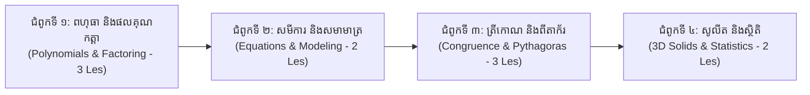

# ScienceKH — Grade 8 Mathematics (គណិតវិទ្យា ថ្នាក់ទី ៨)
## កម្មវិធីសិក្សាផ្លូវការ និងមាតិកាសៀវភៅពុម្ពគោល ក្រសួងអប់រំ យុវជន និងកីឡា

---

## A. Subject Overview
- **Official Khmer Name:** គណិតវិទ្យា ថ្នាក់ទី ៨
- **English Name:** Mathematics Grade 8
- **Target Cycle:** អនុវិទ្យាល័យ (Lower Secondary Education)
- **Official Textbook Reference:** *គណិតវិទ្យា ថ្នាក់ទី ៨*, នាយកដ្ឋានអភិវឌ្ឍកម្មវិធីសិក្សា, ក្រសួងអប់រំ យុវជន និងកីឡា (Ed. 2017–2022).
- **Weekly Class Hours:** 6 Hours / Week.

### Core Competencies Developed:
1. Expansion and factoring of algebraic identities: $(a \pm b)^2 = a^2 \pm 2ab + b^2$, $a^2 - b^2 = (a-b)(a+b)$.
2. Simplifying algebraic fractions and solving first-degree linear equations with fractional coefficients.
3. Proof of triangle congruence (Side-Side-Side, Side-Angle-Side, Angle-Side-Angle) and applying the Pythagorean theorem ($a^2 + b^2 = c^2$).
4. Spatial geometry calculations for curved 3D solids (cylinders, cones, spheres).
5. Statistical analysis of grouped data (median, mode, frequency histograms).

---

## B. Units & Lessons Breakdown (១០ មេរៀន — 10 Lessons)

---

### UNIT 1: ពហុធា ប្រភាគពីជគណិត និងការដាក់ជាផលគុណកត្តា (Polynomials, Fractions & Factoring)
- **Unit Number:** 1 (ជំពូកទី ១)
- **Lessons:**
  1. **Lesson 1.1 (`les-g8-math-01`):** ផលបូក ផលដក និងផលគុណពហុធា (Polynomial Operations)
     - *Key Concept:* Degree of a polynomial, distributing terms $(A+B)(C+D) = AC + AD + BC + BD$, collecting like terms.
     - *Worked Example:* $(2x - 3)(x + 4) = 2x^2 + 8x - 3x - 12 = 2x^2 + 5x - 12$.
  2. **Lesson 1.2 (`les-g8-math-02`):** ប្រភាគពីជគណិត និងការសម្រួល (Algebraic Fractions & Simplification)
     - *Key Concept:* Domain of definition ($Q(x) \ne 0$), factoring common terms in numerator and denominator before canceling.
     - *Worked Example:* $\frac{x^2 - 9}{x^2 + 3x} = \frac{(x-3)(x+3)}{x(x+3)} = \frac{x-3}{x}$ (for $x \ne 0, x \ne -3$).
  3. **Lesson 1.3 (`les-g8-math-06`):** ការដាក់ជាផលគុណកត្តា និងសមភាពគួរចងចាំ (Factorization & Algebraic Identities)
     - *Key Identities:*
       - $(a + b)^2 = a^2 + 2ab + b^2$
       - $(a - b)^2 = a^2 - 2ab + b^2$
       - $a^2 - b^2 = (a - b)(a + b)$
       - Common monomial factoring: $ma + mb = m(a + b)$.

---

### UNIT 2: សមីការដឺក្រេទី១ សមាមាត្រ និងចំណោទ (Linear Equations, Proportions & Modeling)
- **Unit Number:** 2 (ជំពូកទី ២)
- **Lessons:**
  4. **Lesson 2.1 (`les-g8-math-03`):** សមីការដឺក្រេទី១ មានប្រភាគ (Linear Equations with Fractional Coefficients)
     - *Method:* Multiply entire equation by the LCM of denominators to eliminate fractions.
     - *Worked Example:* Solve $\frac{2x - 1}{3} = \frac{x + 4}{5}$. Cross-multiply: $5(2x - 1) = 3(x + 4) \implies 10x - 5 = 3x + 12 \implies 7x = 17 \implies x = \frac{17}{7}$.
  5. **Lesson 2.2 (`les-g8-math-10`):** ការបង្កើតសមីការដោះស្រាយចំណោទសេដ្ឋកិច្ច (Linear Word Problem Modeling)
     - *Application:* Profit/loss modeling, distance-speed-time problems ($d = v \times t$).

---

### UNIT 3: ត្រីកោណ ត្រីកោណប៉ុនគ្នា និងទ្រឹស្តីបទពីតាក័រ (Triangles, Congruence & Pythagoras)
- **Unit Number:** 3 (ជំពូកទី ៣)
- **Lessons:**
  6. **Lesson 3.1 (`les-g8-math-04`):** លក្ខខណ្ឌត្រីកោណប៉ុនគ្នា (Criteria for Triangle Congruence)
     - *Three Cases:*
       1. **ជ្រុង-ជ្រុង-ជ្រុង (SSS):** Three pairs of corresponding sides are equal.
       2. **ជ្រុង-មុំ-ជ្រុង (SAS):** Two pairs of sides and the included angle are equal.
       3. **មុំ-ជ្រុង-មុំ (ASA):** Two angles and the included side are equal.
  7. **Lesson 3.2 (`les-g8-math-07`):** ត្រីកោណកែង និងករណីប៉ុនគ្នាពិសេស (Right-Triangle Congruence Cases)
     - *Special Cases:* Hypotenuse-acute angle (អ៊ីប៉ូតេនុស-មុំស្រួច) and Hypotenuse-leg (អ៊ីប៉ូតេនុស-ជ្រុងជាប់មុំកែង).
  8. **Lesson 3.3 (`les-g8-math-08`):** ទ្រឹស្តីបទពីតាក័រ និងច្រាស (Pythagorean Theorem & Converse)
     - *Theorem:* In right-angled triangle $\triangle ABC$ at $A$: $BC^2 = AB^2 + AC^2 \iff a^2 + b^2 = c^2$.
     - *Converse:* If $BC^2 = AB^2 + AC^2$, then $\triangle ABC$ is a right triangle at $A$.
     - *Worked Example:* If $AB = 6\text{ cm}$ and $AC = 8\text{ cm}$, $BC = \sqrt{6^2 + 8^2} = \sqrt{36 + 64} = \sqrt{100} = 10\text{ cm}$.

---

### UNIT 4: សូលីតកោង ប្លង់កូអរដោនេ និងស្ថិតិ (Curved Solids, Coordinates & Statistics)
- **Unit Number:** 4 (ជំពូកទី ៤)
- **Lessons:**
  9. **Lesson 4.1 (`les-g8-math-05`):** សូលីតកោង ស៊ីឡាំង កោន និងស្វ៊ែរ (Curved Solids: Cylinders, Cones, Spheres)
     - *Cylinder Volume:* $V = \pi r^2 h$; Lateral Area: $S_{lat} = 2\pi r h$.
     - *Cone Volume:* $V = \frac{1}{3} \pi r^2 h$; Sphere Volume: $V = \frac{4}{3} \pi r^3$.
  10. **Lesson 4.2 (`les-g8-math-09`):** ស្ថិតិទិន្នន័យផ្គុំជាថ្នាក់ និងមេដ្យាន (Grouped Data Statistics & Median)
      - *Main Concepts:* Class intervals $[a, b)$, class midpoint $x_i = \frac{a+b}{2}$, median position $\frac{N}{2}$, modal class.

---

## C. Grade 8 Mathematics Vocabulary Table

| Khmer Term | English Term | Academic Definition | Didactic Explanation | Contextual Example |
|---|---|---|---|---|
| ការដាក់ជាផលគុណកត្តា | Factorization | ការបំប្លែងពហុធាឱ្យទៅជាផលគុណនៃកន្សោមដឺក្រេទាបជាង | ធ្វើឱ្យកន្សោមពីជគណិតងាយស្រួលសម្រួល | $x^2 - 16 = (x-4)(x+4)$ |
| ត្រីកោណប៉ុនគ្នា | Congruent Triangles | ត្រីកោណពីរដែលមានជ្រុងត្រូវគ្នារៀងគ្នាស្មើគ្នា និងមុំត្រូវគ្នាស្មើគ្នា | ត្រីកោណដែលមានរាង និងទំហំដូចគ្នាបេះបិទ | $\triangle ABC \cong \triangle DEF$ |
| ទ្រឹស្តីបទពីតាក័រ | Pythagorean Theorem | ការ៉េនៃអ៊ីប៉ូតេនុសស្មើផលបូកការ៉េនៃជ្រុងជាប់មុំកែង $c^2=a^2+b^2$ | រូបមន្តរកប្រវែងជ្រុងក្នុងត្រីកោណកែង | ជ្រុង 3-4-5 ឬ 5-12-13 |
| អ៊ីប៉ូតេនុស | Hypotenuse | ជ្រុងដែលឈមនឹងមុំកែងក្នុងត្រីកោណកែង (ជ្រុងវែងជាងគេ) | ជ្រុងដែលទ្រទម្ងន់ត្រីកោណកែង | ជ្រុង $BC$ ក្នុង $\triangle ABC$ កែងត្រង់ $A$ |
| ស៊ីឡាំង | Cylinder | សូលីតដែលមានបាតពីរជារង្វង់ស្របគ្នានិងផ្ទៃខាងជាផ្ទៃកោង | ប្រអប់ទឹកដោះគោខាប់ កំប៉ុងភេសជ្ជៈ | មាឌស៊ីឡាំង $V = \pi r^2 h$ |
