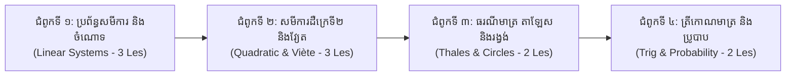

# ScienceKH — Grade 9 Mathematics (គណិតវិទ្យា ថ្នាក់ទី ៩ ឌីប្លូម)
## កម្មវិធីសិក្សាផ្លូវការ និងវិញ្ញាសាត្រៀមប្រឡងឌីប្លូម MoEYS

---

## A. Subject Overview
- **Official Khmer Name:** គណិតវិទ្យា ថ្នាក់ទី ៩
- **English Name:** Mathematics Grade 9 (Brevet / Diploma Level)
- **Target Cycle:** ថ្នាក់ត្រៀមប្រឡងសញ្ញាបត្រមធ្យមសិក្សាបឋមភូមិ (ឌីប្លូម)
- **Official Textbook Reference:** *គណិតវិទ្យា ថ្នាក់ទី ៩*, នាយកដ្ឋានអភិវឌ្ឍកម្មវិធីសិក្សា, ក្រសួងអប់រំ យុវជន និងកីឡា (Ed. 2017–2023).
- **Weekly Class Hours:** 6 Hours / Week (approx. 180 hours/year).
- **National Exam Weighting:** 100 Marks (Core Subject).

---

## B. Units & Lessons Breakdown (១០ មេរៀន — 10 Lessons)

---

### UNIT 1: ប្រព័ន្ធសមីការដឺក្រេទី១ មានពីរអថេរ និងចំណោទ (Linear Systems & Modeling)
- **Unit Number:** 1 (ជំពូកទី ១)
- **Lessons:**
  1. **Lesson 1.1 (`les-g9-math-01`):** ប្រព័ន្ធសមីការដឺក្រេទី១ មានពីរអថេរ (Systems of Linear Equations)
     - *Standard Form:* $\begin{cases} ax + by = c \\ a'x + b'y = c' \end{cases}$.
     - *Solving Methods:*
       1. **វិធីបូកបំបាត់ (Addition Elimination):** Multiply coefficients to cancel one variable.
       2. **វិធីជំនួស (Substitution):** Express $y = \frac{c - ax}{b}$ and substitute into the second equation.
       3. **ដេទែមីណង់ (Cramer's Rule):** $D = ab' - a'b$, $D_x = cb' - c'b$, $D_y = ac' - a'c \implies x = \frac{D_x}{D}, y = \frac{D_y}{D}$ (for $D \ne 0$).
  2. **Lesson 1.2 (`les-g9-math-02`):** ការដោះស្រាយចំណោទដោយប្រើប្រព័ន្ធសមីការ (System Word Problem Applications)
     - *Brevet Classic Problem:* Number of adult and child tickets, coin sums, speed and stream current problems.
  3. **Lesson 1.3 (`les-g9-math-08`):** អនុគមន៍លីនេអ៊ែរ និងក្រាហ្វបន្ទាត់ត្រង់ (Linear Functions & Slope $y=ax+b$)
     - *Concepts:* Slope (មេគុណប្រាប់ទិស $a = \frac{y_2 - y_1}{x_2 - x_1}$), y-intercept $b$. Parallel lines have equal slopes ($a = a'$); perpendicular lines have slopes whose product is $-1$ ($a \cdot a' = -1$).

---

### UNIT 2: សមីការដឺក្រេទី២ និងទំនាក់ទំនងវ្យែត (Quadratic Equations & Viète Relations)
- **Unit Number:** 2 (ជំពូកទី ២)
- **Lessons:**
  4. **Lesson 2.1 (`les-g9-math-03`):** សមីការដឺក្រេទី២ មានមួយអថេរ (Solving Quadratic Equations via $\Delta$)
     - *General Form:* $ax^2 + bx + c = 0$ ($a \ne 0$).
     - *Discriminant:* $\Delta = b^2 - 4ac$.
       - If $\Delta > 0$: Two distinct real roots $x_1 = \frac{-b - \sqrt{\Delta}}{2a}$, $x_2 = \frac{-b + \sqrt{\Delta}}{2a}$.
       - If $\Delta = 0$: One double root $x_1 = x_2 = -\frac{b}{2a}$.
       - If $\Delta < 0$: No real roots.
     - *Reduced Discriminant:* When $b = 2b'$, $\Delta' = b'^2 - ac \implies x = \frac{-b' \pm \sqrt{\Delta'}}{a}$.
  5. **Lesson 2.2 (`les-g9-math-06`):** ទំនាក់ទំនងវ្យែត និងការរកផលបូក-ផលគុណឫស (Viète's Relations)
     - *Formulas:* Sum of roots $S = x_1 + x_2 = -\frac{b}{a}$; Product of roots $P = x_1 \cdot x_2 = \frac{c}{a}$.
     - *Special Cases:*
       - If $a + b + c = 0 \implies x_1 = 1, x_2 = \frac{c}{a}$.
       - If $a - b + c = 0 \implies x_1 = -1, x_2 = -\frac{c}{a}$.
     - *Forming Equations from Roots:* Any two numbers with sum $S$ and product $P$ are roots of $X^2 - SX + P = 0$.
  6. **Lesson 2.3 (`les-g9-math-07`):** ចំណោទសមីការដឺក្រេទី២ ក្នុងវិញ្ញាសាឌីប្លូម (Quadratic Geometry & Physics Word Problems)
     - *Application:* Finding rectangular dimensions given perimeter and area ($S$ and $P$).

---

### UNIT 3: ធរណីមាត្រក្នុងប្លង់ ទ្រឹស្តីបទតាឡែស និងរង្វង់ (Thales Theorem & Circle Geometry)
- **Unit Number:** 3 (ជំពូកទី ៣)
- **Lessons:**
  7. **Lesson 3.1 (`les-g9-math-04`):** ទ្រឹស្តីបទតាឡែសក្នុងត្រីកោណ (Thales Theorem in Triangles)
     - *Theorem:* In $\triangle ABC$, if line $(MN) \parallel (BC)$ with $M \in [AB]$ and $N \in [AC]$, then $\frac{AM}{AB} = \frac{AN}{AC} = \frac{MN}{BC}$.
     - *Converse Theorem:* Used to prove two lines are parallel.
  8. **Lesson 3.2 (`les-g9-math-09`):** ចតុកោណចារឹកក្នុងរង្វង់ និងមុំចារឹក (Inscribed Angles & Cyclic Quadrilaterals)
     - *Inscribed Angle Theorem:* An inscribed angle equals half the intercepted central angle ($\angle AMB = \frac{1}{2} \angle AOB$).
     - *Cyclic Quadrilateral Property:* Opposite angles sum to $180^\circ$ ($\angle A + \angle C = 180^\circ$, $\angle B + \angle D = 180^\circ$).

---

### UNIT 4: ត្រីកោណមាត្រក្នុងត្រីកោណកែង និងប្រូបាប៊ីលីតេ (Trigonometry & Laplace Probability)
- **Unit Number:** 4 (ជំពូកទី ៤)
- **Lessons:**
  9. **Lesson 4.1 (`les-g9-math-05`):** ផលធៀបត្រីកោណមាត្រក្នុងត្រីកោណកែង (Trigonometric Ratios in Right Triangles)
     - *Definitions:* $\sin\theta = \frac{\text{ឈម (Opposite)}}{\text{អ៊ីប៉ូតេនុស (Hypotenuse)}}$, $\cos\theta = \frac{\text{ជាប់ (Adjacent)}}{\text{អ៊ីប៉ូតេនុស}}$, $\tan\theta = \frac{\text{ឈម}}{\text{ជាប់}}$.
     - *Fundamental Identities:* $\sin^2\theta + \cos^2\theta = 1$; $\tan\theta = \frac{\sin\theta}{\cos\theta}$.
     - *Standard Angles:*
       - $30^\circ$: $\sin = \frac{1}{2}, \cos = \frac{\sqrt{3}}{2}, \tan = \frac{\sqrt{3}}{3}$
       - $45^\circ$: $\sin = \frac{\sqrt{2}}{2}, \cos = \frac{\sqrt{2}}{2}, \tan = 1$
       - $60^\circ$: $\sin = \frac{\sqrt{3}}{2}, \cos = \frac{1}{2}, \tan = \sqrt{3}$.
  10. **Lesson 4.2 (`les-g9-math-10`):** ប្រូបាប៊ីលីតេបឋម និងដើមឈើប្រូបាប (Laplace Classical Probability)
      - *Formula:* $P(A) = \frac{n(A)}{n(S)} = \frac{\text{ចំនួនករណីស្រប}}{\text{ចំនួនករណីអាច}}$ ($0 \le P(A) \le 1$). Complementary rule: $P(\bar{A}) = 1 - P(A)$.

---

## C. Grade 9 Mathematics Vocabulary Table

| Khmer Term | English Term | Academic Definition | Didactic Explanation | Contextual Example |
|---|---|---|---|---|
| ប្រព័ន្ធសមីការ | System of Equations | សំណុំនៃសមីការពីរឬច្រើនដែលមានអថេររួមគ្នា | ការស្វែងរកតម្លៃ $(x,y)$ ផ្ទៀងផ្ទាត់សមីការទាំងពីរព្រមគ្នា | $\begin{cases} x+y=10 \\ 2x-y=5 \end{cases} \implies (5,5)$ |
| ឌីស្គ្រីមីណង់ | Discriminant ($\Delta$) | កន្សោមពីជគណិត $\Delta = b^2 - 4ac$ កំណត់ចំនួនឫសនៃសមីការដឺក្រេទី២ | ឧបករណ៍វិនិច្ឆ័យឫសសមីការដឺក្រេទី២ | បើ $\Delta > 0$ មានឫសពីរផ្សេងគ្នា |
| ទំនាក់ទំនងវ្យែត | Viète's Relations | ទំនាក់ទំនងរវាងមេគុណ និងឫស៖ $S=-b/a, P=c/a$ | គណនាផលបូកនិងផលគុណឫសដោយមិនបាច់ដោះស្រាយ $\Delta$ | $2x^2-6x+4=0 \implies S=3, P=2$ |
| ទ្រឹស្តីបទតាឡែស | Thales Theorem | បន្ទាត់ស្របកាត់ជ្រុងត្រីកោណបង្កើតបានជាអង្កត់ធៀបសមាមាត្រ | ប្រើសម្រាប់គណនាប្រវែងជ្រុង និងបញ្ជាក់បន្ទាត់ស្រប | $\frac{AM}{AB} = \frac{AN}{AC}$ |
| ចតុកោណចារឹក | Cyclic Quadrilateral | ចតុកោណដែលកំពូលទាំងបួនស្ថិតនៅលើរង្វង់តែមួយ | ចតុកោណដែលមានផលបូកមុំឈមស្មើ $180^\circ$ | $\angle A + \angle C = 180^\circ$ |
| ប្រូបាប៊ីលីតេឡាផ្លាស | Laplace Probability | ផលធៀបនៃចំនួនករណីស្រប និងចំនួនករណីអាច $P(A) = n/N$ | កម្រិតប្រាកដនិយមនៃព្រឹត្តិការណ៍ចៃដន្យ | ចាប់បាល់ក្រហម $P = 3/10 = 0.3$ |

---

## D. Authentic Brevet Examination Practice Problems

> [!NOTE]
> The following problems model the exact structure of Cambodian National Brevet (ឌីប្លូម) examinations administered by MoEYS.

### Brevet Model Problem 1: Algebra & Linear Systems (25 Marks)
ដោះស្រាយប្រព័ន្ធសមីការខាងក្រោម៖
$$\begin{cases} 3x + 2y = 22 \\ 5x - y = 15 \end{cases}$$
- **Solution:**
  1. From equation (2): $y = 5x - 15$.
  2. Substitute into equation (1): $3x + 2(5x - 15) = 22 \implies 3x + 10x - 30 = 22 \implies 13x = 52 \implies x = \frac{52}{13} = 4$.
  3. Find $y$: $y = 5(4) - 15 = 20 - 15 = 5$.
  4. Final Answer: $(x, y) = (4, 5)$.

### Brevet Model Problem 2: Quadratic Equations & Viète (25 Marks)
គេឱ្យសមីការដឺក្រេទី២ $2x^2 - 7x + 3 = 0$។
a. គណនា $\Delta$ រួចទាញរកឫស $x_1$ និង $x_2$ នៃសមីការ។
b. ផ្ទៀងផ្ទាត់ផលបូក និងផលគុណឫសតាមរូបមន្តវ្យែត។
- **Solution:**
  a. $a = 2, b = -7, c = 3$. $\Delta = (-7)^2 - 4(2)(3) = 49 - 24 = 25 > 0$.
     $\sqrt{\Delta} = \sqrt{25} = 5$.
     $x_1 = \frac{-(-7) - 5}{2(2)} = \frac{7 - 5}{4} = \frac{2}{4} = \frac{1}{2}$.
     $x_2 = \frac{-(-7) + 5}{2(2)} = \frac{7 + 5}{4} = \frac{12}{4} = 3$.
  b. តាមវ្យែត៖ $S = x_1 + x_2 = \frac{1}{2} + 3 = \frac{7}{2} = -\frac{b}{a} = -\frac{-7}{2} = \frac{7}{2}$ (ពិត)។
     $P = x_1 \cdot x_2 = \frac{1}{2} \times 3 = \frac{3}{2} = \frac{c}{a} = \frac{3}{2}$ (ពិត)។
