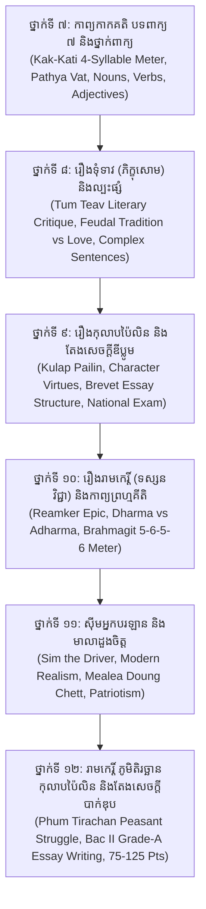
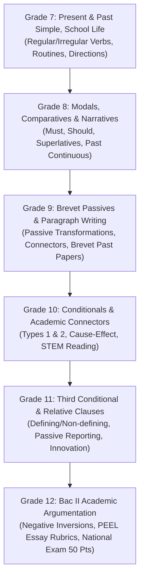

# ScienceKH — MoEYS Languages Progression Map (Grades 7–12)
## ផែនទីដំណើរវិវត្តន៍ភាសា (ភាសាខ្មែរ និងភាសាអង់គ្លេស) តាមស្ដង់ដារ MoEYS

> [!IMPORTANT]
> Language education under the MoEYS curriculum bridges national cultural heritage with 21st-century global communication. Khmer Language & Literature constitutes a major national exam pillar (75 to 125 marks), while English serves as the primary international academic language.

---

## 1. Khmer Language & Literature (ភាសាខ្មែរ និងអក្សរសាស្ត្រ) Progression

### Khmer Literary Analysis Milestones:
| Grade | Primary Literary Work | Author & Era | Key Analytical Themes | Composition / Grammar Focus |
|---|---|---|---|---|
| **Grade 7** | *កំណាព្យប្រពៃណីខ្មែរ* | បុរាណកាល | កតញ្ញូតាធម៌ ការគោរពមាតាបិតា ធម្មជាតិ | កាព្យបទកាកគតិ (២៨ ព្យាង្គ), បទពាក្យ ៧, ថ្នាក់ពាក្យ |
| **Grade 8** | *រឿងទុំទាវ* | ភិក្ខុសោម (គ.ស. ១៩១៥) | ទំនាស់រវាងស្នេហានិងប្រពៃណី ការជិះជាន់សក្តិភូមិ | ល្បះទោល ល្បះផ្សំ ឈ្នាប់ និងការសរសេរកថាខណ្ឌ |
| **Grade 9** | *រឿងកុលាបប៉ៃលិន* | ញ៉ុក ថែម (គ.ស. ១៩៤៣) | គុណធម៌ ភាពស្មោះត្រង់ វណ្ណៈកម្មករ តម្លៃមនុស្ស | តែងសេចក្តីពិពណ៌នា និងពន្យល់ (វិញ្ញាសាឌីប្លូម) |
| **Grade 10** | *រឿងរាមកេរ្តិ៍* | បុរាណកាល (សតវត្សទី ១៦-១៧) | ធម៌ឈ្នះអធម៌ សច្ចធម៌ ភក្តីភាព មនោគមវិជ្ជាស្តេច | កាព្យបទព្រហ្មគីតិ (២២ ព្យាង្គ) និងបទឥន្ទ្រជិត |
| **Grade 11** | *រឿងស៊ីមអ្នកបរឡាន* *រឿងមាលាដួងចិត្ត* | អុឹម ឈុម / នូ ហាច (ទសវត្សរ៍ ១៩៥០-១៩៧០) | ស្មារតីសាមគ្គីភាពវណ្ណៈកម្មករ ស្នេហាជាតិ | តែងសេចក្តីពិភាក្សា គំនិតស្រប និងគំនិតជំទាស់ |
| **Grade 12** | *រឿងភូមិតិរច្ឆាន* *រឿងរាមកេរ្តិ៍* *រឿងកុលាបប៉ៃលិន* | ឌឹក គាម & ឌឿក អំ (១៩៦៤) ញ៉ុក ថែម / ស្នាដៃបុរាណ | ការបះបោររបស់កសិករភូមិក្រាំងលាវប្រឆាំងពន្ធដារបារាំង (បាដេស) | វិធីសាស្ត្រតែងសេចក្តីបាក់ឌុប (ពន្យល់ ពិភាក្សា ប្រៀបធៀប) យកនិទ្ទេស A |

---

## 2. English as a Foreign Language Progression

### English Language Competency Milestones:
- **Grade 7:** Foundation grammar (Present simple, past simple affirmative/negative/interrogative, daily routine discourse).
- **Grade 8:** Nuanced modal auxiliaries (*must* vs *have to*, *should* vs *ought to*), comparisons (*more ... than*, *-est*), and sequential narratives.
- **Grade 9 (Brevet):** Passive voice structure (*Object + be + V3*), cohesive devices (*therefore, however, in addition*), and authentic Brevet reading passages.
- **Grade 10:** First and second conditionals, real vs hypothetical scenario framing, and academic scientific vocabulary.
- **Grade 11:** Counterfactual past conditionals (*If + had V3, would have V3*), relative pronoun accuracy (*who, which, that, whose, where*), and synthesis of non-fiction articles.
- **Grade 12 (Bac II):** Advanced syntactic structures (negative inversion: *"Not only... but also"*, *"Rarely do we find..."*), PEEL argumentative paragraph design, and timed national examination paper drills.
