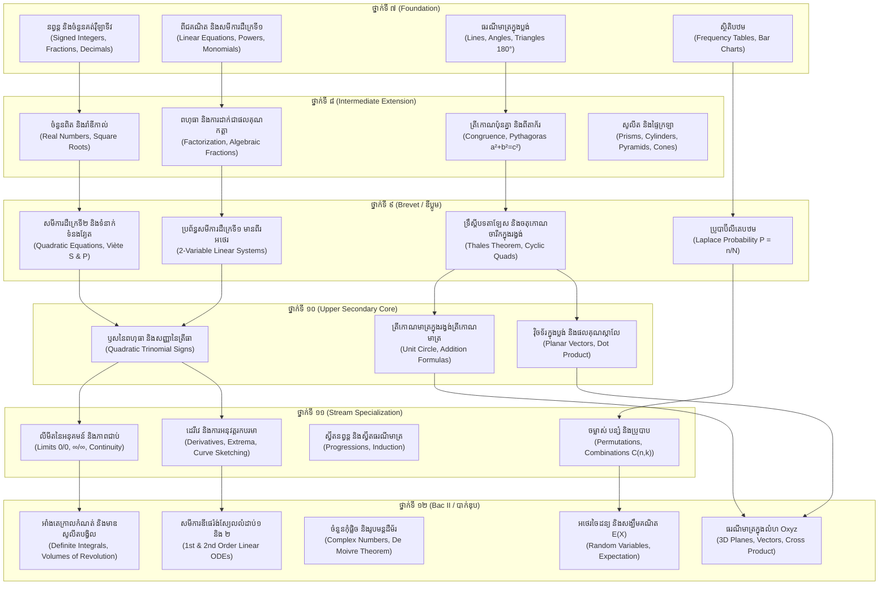

# ScienceKH — MoEYS Mathematics Grade-to-Grade Progression Map (Grades 7–12)
## ផែនទីដំណើរវិវត្តន៍ចំណេះដឹងគណិតវិទ្យា ថ្នាក់ទី ៧ ដល់ ទី ១២ តាមស្ដង់ដារ MoEYS

> [!IMPORTANT]
> This map articulates the vertical progression of mathematical competencies from foundational junior concepts to advanced Baccalaureate II calculus and analytical geometry. It ensures prerequisite mastery, eliminates pedagogical blind spots, and aligns with the **Curriculum Framework of General Education and Technical Education (MoEYS)**.

---

## 1. High-Level Mathematical Progression Architecture

---

## 2. Topic-by-Topic Vertical Learning Progression Table

| Mathematical Domain | Grade 7 (ថ្នាក់ទី ៧) | Grade 8 (ថ្នាក់ទី ៨) | Grade 9 (ថ្នាក់ទី ៩) | Grade 10 (ថ្នាក់ទី ១០) | Grade 11 (ថ្នាក់ទី ១១) | Grade 12 (ថ្នាក់ទី ១២) |
|---|---|---|---|---|---|---|
| **Numbers & Operations** *(នព្វន្ត និងចំនួន)* | ចំនួនគត់រ៉ឺឡាទីវ, ប្រភាគ, ទសភាគ, GCD/LCM | ចំនួនសនិទាន និងអសនិទាន, ឫសការ៉េ $\sqrt{a}$ | រ៉ាឌីកាល់ និងការគណនាកន្សោមរ៉ាឌីកាល់ | ចំនួនកុំផ្លិចកម្រិតដំបូង, ម៉ូឌុល | ទម្រង់ពីជគណិត និងត្រីកោណមាត្រ | រូបមន្តដឺម័រ $(\cos\theta + i\sin\theta)^n$, ឫសទី $n$ |
| **Algebra & Equations** *(ពីជគណិត និងសមីការ)* | សមីការ $ax+b=c$, កន្សោមពីជគណិត | ពហុធា, ផលគុណកត្តា $(a\pm b)^2$, $a^2-b^2$ | សមីការដឺក្រេទី២ $ax^2+bx+c=0$, $\Delta$, វ្យែត $S, P$ | សញ្ញាត្រីធា, វិសមីការដឺក្រេទី២, ប៉ារ៉ាម៉ែត្រ | ស្វ៊ីតនព្វន្ត ($u_n=u_1+(n-1)d$), ស្វ៊ីតធរណីមាត្រ ($u_n=u_1q^{n-1}$) | សមីការឌីផេរ៉ង់ស្យែល $y'+ay=0$, $ay''+by'+cy=0$ |
| **Linear Systems** *(ប្រព័ន្ធសមីការ)* | សមាមាត្រ និងផលធៀប | សមីការមានពីរអថេរកម្រិតបឋម | ប្រព័ន្ធសមីការ ២ អថេរ (ជំនួស បូកបំបាត់ ដេទែមីណង់) | ប្រព័ន្ធសមីការ ៣ អថេរ កម្រិតគ្រឹះ | ម៉ាទ្រីស និងប្រព័ន្ធសមីការលីនេអ៊ែរ | ការអនុវត្តប្រព័ន្ធសមីការក្នុងធរណីមាត្រ Oxyz |
| **Functions & Calculus** *(អនុគមន៍ និងគណិតវិភាគ)* | គំនូសតាងចំណុចក្នុងប្លង់កូអរដោនេ | បន្ទាត់ត្រង់ $y=ax+b$, មេគុណប្រាប់ទិស | អនុគមន៍លីនេអ៊ែរ និងអនុគមន៍ថេរ | អនុគមន៍ដឺក្រេទី២ (ប៉ារ៉ាបូល កំពូល អ័ក្សឆ្លុះ) | លីមីត ($\frac{0}{0}, \frac{\infty}{\infty}$), ដេរីវេ ($u\cdot v, \frac{u}{v}, u^n$), បរមា | អនុគមន៍ $\ln x, e^x$, អាំងតេក្រាល $\int f(x)dx$, មាឌ $V=\pi\int f^2dx$ |
| **Geometry** *(ធរណីមាត្រ)* | បន្ទាត់ស្រប បន្ទាត់កែង មុំ ផលបូកមុំត្រីកោណ $180^\circ$ | ត្រីកោណប៉ុនគ្នា, ពីតាក័រ $c^2=a^2+b^2$ | ទ្រឹស្តីបទតាឡែស, មុំចារឹកក្នុងរង្វង់, ចតុកោណចារឹក | វ៉ិចទ័រក្នុងប្លង់, ផលគុណស្កាលែ $\vec{u}\cdot\vec{v}$ | ប្លង់កោនិក (ប៉ារ៉ាបូល អេលីប អ៊ីពែបូល) | ធរណីមាត្រក្នុងលំហ Oxyz, សមីការប្លង់, ចម្ងាយទៅប្លង់ |
| **Trigonometry** *(ត្រីកោណមាត្រ)* | ផលធៀបប្រវែងក្នុងត្រីកោណកែង | គំនិតត្រីកោណមាត្របឋម | ស៊ីនុស កូស៊ីនុស តង់សង់ ក្នុងត្រីកោណកែង | រង្វង់ត្រីកោណមាត្រ, រូបមន្តបូក, រូបមន្តគុណពីរ | សមីការត្រីកោណមាត្រ $\sin x=a, \cos x=b$, ដេរីវេ | អាំងតេក្រាលអនុគមន៍ត្រីកោណមាត្រ, កុំផ្លិច |
| **Statistics & Probability** *(ស្ថិតិ និងប្រូបាប)* | តារាងប្រេកង់, ដ្យាក្រាមសសរ, មធ្យមភាគ | ប្រេកង់កើន, មេដ្យាន, ម៉ូត, ហ៊ីស្តូក្រាម | ប្រូបាប៊ីលីតេឡាផ្លាស $P=\frac{n(A)}{n(S)}$, ដើមឈើប្រូបាប | លំហសំណាក, ច្បាប់បូក និងគុណប្រូបាប | ចម្លាស់ $P_n$, ច្រន stets $A_n^k$, បន្សំ $C_n^k$ | អថេរចៃដន្យដាច់, សង្ឃឹមគណិត $E(X)$, វ៉ារ្យ៉ង់ $V(X)$ |

---

## 3. Prerequisite Knowledge & Transition Rules

1. **Grade 7 → Grade 8 Transition:**
   - Mastery of signed integer signs ($(-)\times(-) = (+)$) is required before factoring polynomials and evaluating radicals in Grade 8.
   - Fractions and LCM/GCD arithmetic must be solid before tackling algebraic fractions ($\frac{P(x)}{Q(x)}$).

2. **Grade 8 → Grade 9 (Brevet Readiness):**
   - Factoring identities ($(a-b)(a+b)=a^2-b^2$) form the direct mechanical basis for solving quadratic equations via $\Delta = b^2-4ac$ and Viète formulas in Grade 9.
   - Planar congruence and Pythagorean theorem are absolute prerequisites for Thales projections and circle theorems.

3. **Grade 9 → Grade 10 (Secondary Integration):**
   - Grade 9 quadratic solving unlocks Grade 10 polynomial analysis and trinomial sign tables ($f(x) > 0$).
   - Right-triangle trigonometry transitions to the general unit circle with signed angles in radians.

4. **Grade 10 → Grade 11 (Advanced Analysis):**
   - The functional concept and polynomial algebra prepare students for the delta-epsilon limit definition and differential calculus ($f'(x) = \lim_{h \to 0} \frac{f(x+h)-f(x)}{h}$).

5. **Grade 11 → Grade 12 (Baccalaureate II Mastery):**
   - Derivatives and limits in Grade 11 directly enable indefinite and definite Riemann integration in Grade 12.
   - Vector dot products from Grade 10 expand into 3D cross products and normal vectors of planes ($\vec{n}=(A,B,C)$) in space.
