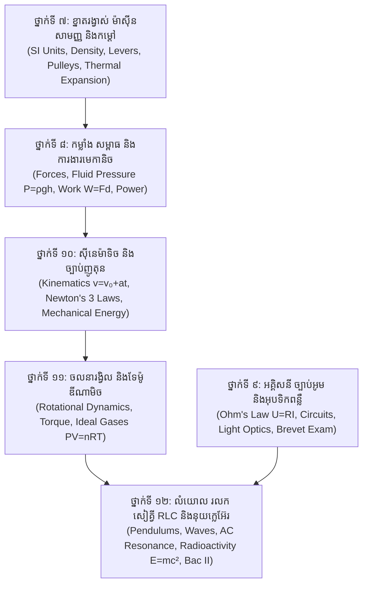
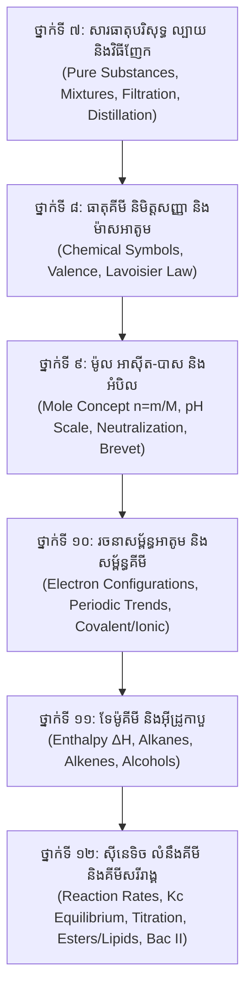
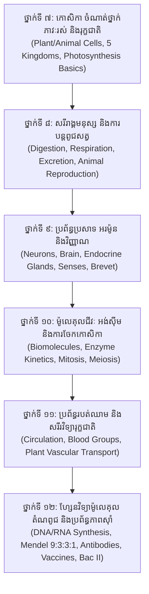
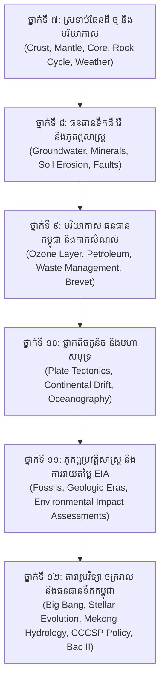

# ScienceKH — MoEYS Science Grade-to-Grade Progression Map (Grades 7–12)
## ផែនទីដំណើរវិវត្តន៍វិទ្យាសាស្ត្រ (រូបវិទ្យា គីមីវិទ្យា ជីវវិទ្យា ផែនដីវិទ្យា) តាមស្ដង់ដារ MoEYS

> [!IMPORTANT]
> In accordance with the **Curriculum Framework of General Education and Technical Education (MoEYS)**, science education is taught as four distinct integrated scientific disciplines in Lower Secondary (Grades 7–9) and expands into specialized Major STEM tracks in Upper Secondary (Grades 10–12 Science Stream).

---

## 1. Physics (រូបវិទ្យា) Progression: Mechanics to Nuclear Energy

### Physics Competency Milestones:
- **Grades 7–8:** Qualitative and basic quantitative measurement of physical phenomena (density, force vectors, pressure, simple mechanical advantage).
- **Grade 9 (Brevet):** Circuit analysis using Ohm's law ($U = R \cdot I$), power ($P = U \cdot I$), and focal length optical geometry.
- **Grade 10:** Rigorous vector mechanics applying Newton's second law ($\Sigma \vec{F} = m\vec{a}$) and work-energy theorem ($\Delta E_k = W$).
- **Grade 11:** Multi-body rotational dynamics, torque ($\tau = rF\sin\theta$), and thermodynamic state cycles.
- **Grade 12 (Bac II):** Advanced oscillatory mechanics ($T = 2\pi\sqrt{l/g}$), RLC impedance vectors, resonance, radioactive exponential decay ($N(t) = N_0 e^{-\lambda t}$), and mass-energy equivalence ($E = mc^2$).

---

## 2. Chemistry (គីមីវិទ្យា) Progression: Substances to Organic Kinetics

### Chemistry Competency Milestones:
- **Grades 7–8:** Macroscopic matter classification, atomic symbols, chemical formulas, and mass conservation.
- **Grade 9 (Brevet):** Stoichiometric calculations with the mole ($n = \frac{m}{M} = \frac{V}{22.4} = C \times V$), pH scale ($0-14$), and metal activity.
- **Grade 10:** Subatomic orbital theory ($1s^2 2s^2 2p^6...$), electronegativity gradients, and octet-rule chemical bonding.
- **Grade 11:** Thermochemical energy diagrams ($\Delta H$) and aliphatic hydrocarbon reactivity mechanisms.
- **Grade 12 (Bac II):** Kinetic rate laws ($v = k[A]^m[B]^n$), dynamic chemical equilibrium constants ($K_c, K_p$), Le Chatelier shifts, rigorous acid-base pH calculations, and esterification/saponification mechanisms.

---

## 3. Biology (ជីវវិទ្យា) Progression: Cells to Molecular Genetics & Immunology

### Biology Competency Milestones:
- **Grades 7–8:** Microscopic cell visualization, classification of biological diversity, organ systems, and food energy transfer.
- **Grade 9 (Brevet):** Reflex neural arcs, synaptic chemical neurotransmission, and homeostatic hormonal feedback.
- **Grade 10:** Macromolecular biochemistry (carbohydrates, lipids, proteins, ATP), enzyme action, and cell duplication via mitosis and meiosis.
- **Grade 11:** Cardiovascular hemodynamics, antigen-antibody agglutination, and xylem/phloem fluid transport.
- **Grade 12 (Bac II):** DNA double-helix semi-conservative replication, transcription into mRNA, ribosomal translation, Mendelian dihybrid inheritance ($9:3:3:1$), adaptive immunity (B/T-cells), and evolutionary natural selection.

---

## 4. Earth & Environmental Science (ផែនដី និងបរិស្ថានវិទ្យា) Progression

### Earth Science Competency Milestones:
- **Grades 7–9:** Local lithosphere, hydrosphere, atmosphere, mineral resources of Cambodia, and municipal waste management.
- **Grades 10–11:** Deep Earth geophysics, tectonic plate subduction, earthquake epicenter triangulation, and environmental impact assessments.
- **Grade 12 (Bac II):** Astrophysics, Big Bang nucleosynthesis, stellar life cycles (supernovae, white dwarfs, black holes), Mekong-Tonle Sap annual hydrological reversal, and national climate change adaptation policy.
