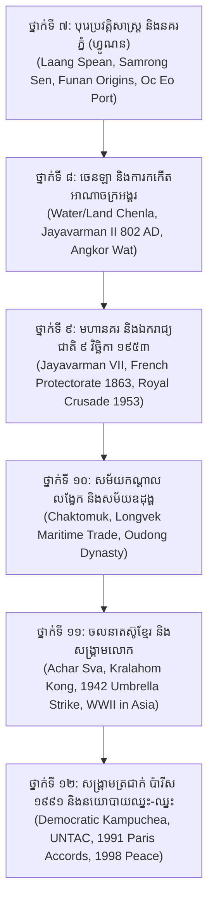
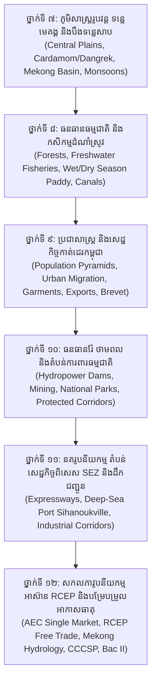
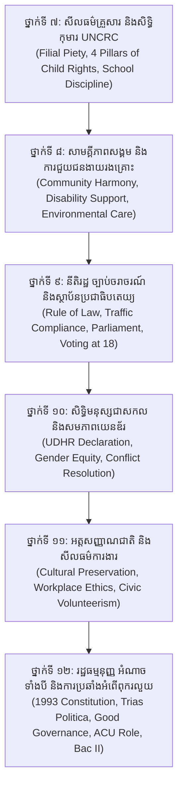

# ScienceKH — MoEYS Social Sciences Progression Map (Grades 7–12)
## ផែនទីដំណើរវិវត្តន៍វិទ្យាសាស្ត្រសង្គម (ប្រវត្តិវិទ្យា ភូមិវិទ្យា សីលធម៌-ពលរដ្ឋ) តាមស្ដង់ដារ MoEYS

> [!IMPORTANT]
> Social Sciences develop national identity, critical civic reasoning, geopolitical awareness, and historical consciousness. In Upper Secondary (Grades 11–12), they constitute the core 300-point major battery for the **Social Science Stream** in the National Baccalaureate II Examination.

---

## 1. History (ប្រវត្តិវិទ្យា) Progression: Prehistory to Modern Pacification

### History Curricular Milestones:
- **Grade 7:** Archaeology of Neolithic/Bronze age settlements; Funan maritime trade connections with India and Rome.
- **Grade 8:** Fragmentation of Chenla; King Jayavarman II's 802 AD Devaraja ritual on Mount Kulen; Suryavarman II's construction of Angkor Wat.
- **Grade 9 (Brevet):** Jayavarman VII's hospital/road network; French Protectorate of 1863; King Norodom Sihanouk's diplomatic crusade achieving independence on November 9, 1953.
- **Grade 10:** Relocation of royal seat to Chaktomuk and Longvek; international spice trade with Europeans and Asians; Oudong Buddhist legacy.
- **Grade 11:** 19th and 20th century anticolonial uprisings (Achar Sva, Kralahom Kong, Monastic Umbrella Demonstration of 1942).
- **Grade 12 (Bac II):** Contemporary Cambodian history: Khmer Republic (1970–1975), Democratic Kampuchea regime (1975–1979), October 23, 1991 Paris Peace Accords, UNTAC democratic elections, and the 1998 Win-Win Policy pacification.

---

## 2. Geography (ភូមិវិទ្យា) Progression: Landscapes to Geoeconomics

### Geography Curricular Milestones:
- **Grade 7:** 4 physiographic domains of Cambodia; Mekong-Tonle Sap reverse flow mechanism; Southwest/Northeast monsoon weather.
- **Grade 8:** Forestry management, freshwater inland fishery habitats, and wet vs dry season rice agronomy.
- **Grade 9 (Brevet):** Demographic dividends, urbanization indices, garment manufacturing dynamics, and preferential trade access.
- **Grade 10:** Mineral reserves (bauxite, iron, gold), clean hydropower potential, and protected national conservation zones.
- **Grade 11:** Special Economic Zones (SEZs), multi-modal logistics (Phnom Penh-Sihanoukville Expressway, deep-sea container terminals).
- **Grade 12 (Bac II):** Four pillars of national economic growth; ASEAN Economic Community (AEC); RCEP trade pact; climate resilience; and the Phnom Penh 2035 Urban Master Plan.

---

## 3. Moral & Civics (សីលធម៌ និងពលរដ្ឋវិជ្ជា) Progression: Ethics to Constitutional Governance

### Moral & Civics Curricular Milestones:
- **Grade 7:** Filial piety (*កតញ្ញូតាធម៌*), 4 pillars of the UN Convention on the Rights of the Child (survival, development, protection, participation).
- **Grade 8:** Mutual aid, anti-discrimination, public property protection, and community environmental stewardship.
- **Grade 9 (Brevet):** Road safety statutory compliance; structure of the National Assembly, Senate, and Royal Government; voting rights at age 18.
- **Grade 10:** Universal Declaration of Human Rights (UDHR), gender empowerment, and peaceful non-violent dispute resolution.
- **Grade 11:** Safeguarding tangible and intangible national heritage, labor standards, and civic volunteer responsibility.
- **Grade 12 (Bac II):** The 1993 Constitution of Cambodia; separation of legislative, executive, and judicial powers; good governance (transparency, accountability); Anti-Corruption Unit (ACU) legal authority; and professional ethical codes.
