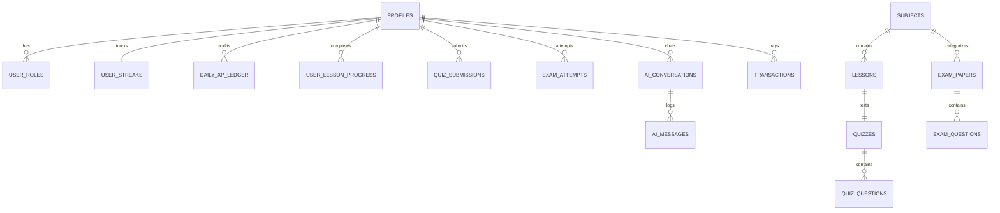

# ScienceKH Database Architecture (Supabase / PostgreSQL)

This directory contains the database migration scripts, master schema, and seed definitions for the **ScienceKH** Grades 7–12 STEM education platform in Cambodia.

---

## 🏛️ Relational Architecture Overview

The database is partitioned into 7 functional domains:

---

## 📂 Core Domains & Data Dictionary

### 1. Identity & Profile Domain
- **`profiles`**: Master student record linked to Supabase Auth (`auth.users(id)`). Stores `full_name`, `grade` (7–12), `xp`, `coins`, `hearts` (0–5), `streak_days`, `league_tier`, `school_name`, and `province`.
- **`user_roles`**: Role-based access control (`student`, `editor`, `admin`).
- **`handle_new_user()` trigger**: Automatically initializes profile and assigns default role upon user registration.

### 2. MoEYS Academic Curriculum Domain
- **`subjects`**: 10 officially recognized subjects aligned with the Cambodia MoEYS national syllabus (Math, Physics, Chemistry, Biology, Earth Science, Khmer, English, ICT, History, Geography).
- **`lessons`**: MoEYS curriculum lessons with bilingual titles, summaries, rich markdown content, estimated completion time, and XP rewards.

### 3. Interactive Assessment & Quiz Domain
- **`quizzes`**: Lesson-level assessments with configurable passing thresholds (`pass_score`, `xp_reward`, `coins_reward`).
- **`quiz_questions`**: Interactive questions supporting `mcq`, `fill_blank`, `order_steps`, and `formula_drag`.
- **`quiz_submissions`**: Student evaluation submissions with timestamped scores and answers.
- **`user_lesson_progress`**: Idempotent tracking of student lesson completion and high scores.

### 4. Gamification & Progression Integrity Domain
- **`user_streaks`**: Anti-cheat streak tracking normalized to Cambodia Timezone (`Asia/Phnom_Penh`, UTC+7).
- **`daily_xp_ledger`**: Enforces daily XP caps (max 2,000 XP/day) to prevent automated bot farming.

### 5. National Examination Prep Domain
- **`exam_papers`**: Real Cambodian BacII (Grade 12) and Brevet (Grade 9) past exam papers.
- **`exam_questions`**: Step-by-step problem statements and official Ministry solutions.
- **`exam_attempts`**: Timed simulation results.

### 6. AI Socratic Tutor Domain
- **`ai_conversations`** & **`ai_messages`**: Chat history between students and Dr. Sokha (Socratic AI STEM Tutor).

### 7. Monetization & KHQR Payments Domain
- **`transactions`**: National Bank of Cambodia (NBC) compliant Bakong KHQR transaction ledger.

---

## 🔒 Security & Row Level Security (RLS)

Every table enforces PostgreSQL Row Level Security (RLS):
1. **Public/Read-Only**: `subjects`, `lessons` (where `is_published = true`), `quizzes`, `quiz_questions`, and public leaderboard aggregates.
2. **Owner-Scoped**: `profiles`, `user_lesson_progress`, `user_streaks`, `quiz_submissions`, `ai_conversations`, `transactions` are strictly limited to `auth.uid() = user_id`.
3. **Role-Protected**: Content creation and deletion require `public.has_role(auth.uid(), 'admin')`.

---

## 🚀 Deployment Instructions

### To initialize a fresh Supabase database:
1. Open your **Supabase Dashboard** > **SQL Editor**.
2. Run `supabase/00_master_schema.sql`.
3. All tables, triggers, indexes, RLS policies, and the 10 MoEYS curriculum subjects will be set up automatically.

